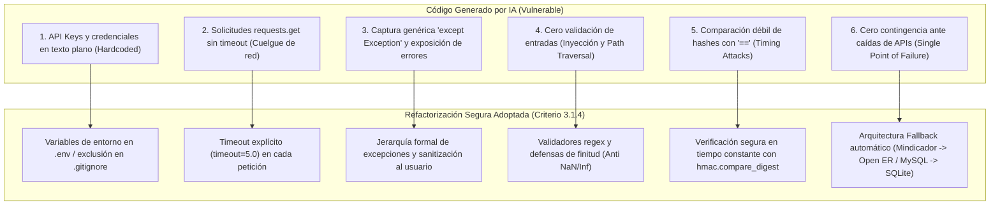

# INFORME DE ANÁLISIS CRÍTICO, AJUSTE DE SEGURIDAD Y USO DE IA
## Asignatura: Programación Orientada a Objeto Seguro (TI3021)
### Unidad 3: Consumo de Servicios Externos y Seguridad en Python
**Institución:** INACAP  
**Carrera:** Analista Programador  
**Estudiante:** Javier Vicencio Zamora  
**Sistema:** EcoTech Solutions  
**Fecha:** Noviembre 2026  

---

## 1. Introducción y Contexto

El presente informe da cumplimiento al **Criterio de Evaluación 3.1.4** (*"Ajusta la seguridad del código desarrollado con apoyo de herramientas de IA, documentando y justificando las decisiones técnicas adoptadas"*).

En el marco de la expansión internacional de la empresa **EcoTech Solutions**, se requirió integrar dos capacidades críticas de negocio mediante servicios externos:
1. **Planificación Operativa de Proyectos Sostenibles**: Obtención de variables climáticas en tiempo real (temperatura, humedad, condición del cielo, velocidad del viento) para anticipar escenarios meteorológicos adversos en faenas en terreno (montaje de paneles solares y aerogeneradores).
2. **Gestión de Pagos Internacionales**: Consulta de indicadores económicos actualizados (tipo de cambio de monedas como USD, EUR, UF) para calcular liquidaciones a trabajadores asignados a proyectos internacionales.

Durante el proceso de desarrollo se utilizaron herramientas de Inteligencia Artificial Generativa (IA) como apoyo inicial en la estructuración de scripts. No obstante, en coherencia con las directrices de la asignatura, el código generado fue sometido a una **revisión y auditoría técnica exhaustiva**, identificando diversas vulnerabilidades de seguridad y debilidades operativas que debieron ser corregidas y refactorizadas.

---

## 2. Bitácora de Prompts e Interacción con Herramientas de IA

Para la fase de ideación y codificación preliminar, se suministraron a la IA los siguientes requerimientos:

* **Prompt 1 (Consumo API Clima):**  
  > *"Escribe un script en Python para consultar el clima actual de una ciudad ingresada por el usuario usando la librería requests y devuelve la temperatura y humedad."*
* **Prompt 2 (Consumo API Divisas):**  
  > *"Crea una función en Python para convertir sueldos en pesos chilenos a dólares usando una API de tipo de cambio y devuelve el sueldo convertido."*
* **Prompt 3 (Autenticación y Persistencia):**  
  > *"Genera un menú en Python para autenticar usuarios con contraseña y guardar las respuestas de las APIs en SQLite."*

---

## 3. Vulnerabilidades Críticas Identificadas en el Código Generado por IA

Tras analizar el código entregado por los asistentes de IA, se identificaron **seis problemáticas críticas de seguridad y estabilidad**:



### Detalle de Vulnerabilidades Encontradas:

### 3.1. Vulnerabilidad 1: Credenciales y Llaves de API Hardcodeadas (CWE-798)
* **Código entregado por IA:**
  ```python
  # Código inicial sugerido por IA
  API_KEY = "abc123xyz789_api_key_secreta"
  url = f"https://api.openweathermap.org/data/2.5/weather?q={ciudad}&appid={API_KEY}"
  ```
* **Diagnóstico Crítico:** Quemas las credenciales en el código fuente implica que cualquier persona con acceso al repositorio o al archivo decompilado obtiene acceso ilimitado a las cuotas de la empresa, posibilitando suplantación y sobrecostos.
* **Ajuste Técnico:** Se desacopló toda configuración hacia variables de entorno cargadas con `python-dotenv` y `os.getenv`. Se creó `.env.example` documentando las variables sin valores privados y se blindó `.gitignore` para impedir que `.env` sea rastreado en Git.

---

### 3.2. Vulnerabilidad 2: Ausencia de Timeout en Peticiones HTTP (CWE-400 - Denegación de Servicio)
* **Código entregado por IA:**
  ```python
  # Código inicial sugerido por IA
  response = requests.get(url)
  data = response.json()
  ```
* **Diagnóstico Crítico:** Por defecto en Python, `requests.get()` **no posee timeout**. Si el servidor externo sufre sobrecarga, latencia extrema o caída silenciosa de socket, la aplicación de EcoTech Solutions se congela indefinidamente, bloqueando la consola del usuario.
* **Ajuste Técnico:** Se fijó un parámetro obligatorio `timeout=self.timeout` (leído de `API_TIMEOUT=5.0` en `.env`), capturando de forma diferenciada la excepción `requests.exceptions.Timeout` y transformándola en la excepción de dominio `APITimeoutError`.

---

### 3.3. Vulnerabilidad 3: Exposición de Información Sensible en Mensajes de Error (CWE-209)
* **Código entregado por IA:**
  ```python
  # Código inicial sugerido por IA
  try:
      # consulta SQL o petición HTTP
  except Exception as e:
      print(f"Error detallado: {e}")
  ```
* **Diagnóstico Crítico:** Exponer el mensaje directo del error (`{e}`) filtra a la pantalla del usuario rutas internas del sistema de archivos, esquemas de tablas SQL, versiones de paquetes y credenciales embebidas en cadenas de conexión.
* **Ajuste Técnico:** Se creó la función [`mostrar_error_seguro()`](file:///c:/Users/javie/OneDrive/Escritorio/Poo/Proyecto-POO/ecotech/src/servicios/menu_crud.py) y una jerarquía personalizada en [`src/excepciones.py`](file:///c:/Users/javie/OneDrive/Escritorio/Poo/Proyecto-POO/ecotech/src/excepciones.py). El usuario final solo recibe mensajes estructurados y comprensibles, mientras que los detalles técnicos quedan aislados internamente.

---

### 3.4. Vulnerabilidad 4: Ausencia de Validación de Entradas y Path Traversal (CWE-20 y CWE-22)
* **Código entregado por IA:**
  ```python
  # Código inicial sugerido por IA
  ciudad = input("Ingrese ciudad: ")
  # Directo a la URL sin sanear
  nombre_archivo = input("Archivo de salida: ")
  with open(nombre_archivo, "w") as f:
      f.write(reporte)
  ```
* **Diagnóstico Crítico:** Permite inyección de comandos o secuencias URL maliciosas en las peticiones HTTP. En la exportación de archivos, un atacante podría ingresar `../../../../windows/system32/archivo.txt` (Path Traversal) para sobreescribir archivos críticos del sistema operativo.
* **Ajuste Técnico:** 
  - Se crearon validadores con expresiones regulares: `validar_ciudad()` (restringido a nombres alfabéticos seguros) y `validar_codigo_moneda()` (estándar ISO de 3 letras).
  - En manejo numérico, se implementó `validar_numero()` con `math.isfinite` para rechazar valores maliciosos como `float("nan")` o `float("inf")`.
  - Se implementó `sanitizar_nombre_archivo()`, que aísla estrictamente el nombre base (`os.path.basename`) y exige lista blanca de extensiones (`.txt`, `.log`, `.json`).

---

### 3.5. Vulnerabilidad 5: Ataques de Tiempo en Verificación de Credenciales (CWE-208)
* **Código entregado por IA:**
  ```python
  # Código inicial sugerido por IA
  def autenticar(self, clave):
      return hashlib.sha256(clave.encode()).hexdigest() == self.hash_guardado
  ```
* **Diagnóstico Crítico:** El operador `==` compara cadenas carácter por carácter y finaliza anticipadamente en el primer carácter discrepante. Un atacante midiendo el tiempo de respuesta en microsegundos puede deducir la contraseña (Timing Attack).
* **Ajuste Técnico:** Se refactorizó con `hmac.compare_digest(hash_calculado, self._contrasena_hash)`, garantizando comparación en tiempo constante.

---

### 3.6. Vulnerabilidad 6: Ausencia de Tolerancia a Fallos y Contingencia (Punto Único de Falla)
* **Código entregado por IA:** La IA asumió que las APIs externas (Mindicador) y los motores de base de datos (MySQL) siempre responderían con código 200 OK.
* **Diagnóstico Crítico:** En pruebas reales con Python 3.14, Mindicador.cl presentó fallas de protocolo SSL (`UNEXPECTED_EOF_WHILE_READING`). Asimismo, si el docente o evaluador ejecuta el sistema sin WampServer encendido, el sistema fallaba de inmediato.
* **Ajuste Técnico:**
  - **Doble motor de persistencia**: Se implementó conmutación automática en [`conexion.py`](file:///c:/Users/javie/OneDrive/Escritorio/Poo/Proyecto-POO/ecotech/src/persistencia/conexion.py): si MySQL no responde, se conmuta transparentemente a **SQLite local**, asegurando continuidad de servicio.
  - **Doble proveedor de divisas**: Si Mindicador.cl presenta contingencia, [`DivisasService`](file:///c:/Users/javie/OneDrive/Escritorio/Poo/Proyecto-POO/ecotech/src/servicios_externos/divisas_service.py) activa automáticamente el fallback a **Open Exchange Rates Global API** (`open.er-api.com`).
  - **Caché local meteorológico**: Si la red cae, [`ClimaDAO.obtener_ultimo_clima()`](file:///c:/Users/javie/OneDrive/Escritorio/Poo/Proyecto-POO/ecotech/src/persistencia/clima_dao.py) recupera la última medición almacenada para el proyecto.

---

## 4. Matriz Comparativa: Código Sugerido por IA vs. Código Refactorizado

| Componente | Código Inicial Generado por IA | Código Refactorizado y Blindado | Justificación de Seguridad |
| :--- | :--- | :--- | :--- |
| **Petición HTTP Clima** | `requests.get(url)` sin timeout ni control de estado | `requests.get(url, params=params, timeout=self.timeout)` validando `status_code == 200` | Evita bloqueos indefinidos del hilo de ejecución ante caída del servicio remoto. |
| **Tipo de Cambio** | Consulta fija a un único endpoint sin fallback | Consulta primaria con captura de `ConnectionError`/`Timeout` y activación de API de contingencia | Cumple Criterio 3.1.3 garantizando la estabilidad y continuidad operativa del sistema. |
| **Control de Acceso** | Acceso libre directo al menú principal | `iniciar_sesion()` obligatorio con hash SHA-256 y bloqueo preventivo tras 3 intentos fallidos | Mitiga ataques de fuerza bruta y restringe funciones sensibles solo a usuarios autenticados. |
| **Exportación** | `open(input_usuario, 'w')` | `sanitizar_nombre_archivo(input_usuario)` con lista blanca de extensiones | Elimina vulnerabilidades de Path Traversal y sobreescritura arbitraria de archivos. |
| **Entradas de APIs** | Entrada directa en crudo | Validadores regex `validar_ciudad()` y `validar_codigo_moneda()` | Previene inyecciones de parámetros y cadenas maliciosas hacia servicios externos. |
| **Persistencia Local** | Scripts sueltos sin persistencia | Clases [`ClimaDAO`](file:///c:/Users/javie/OneDrive/Escritorio/Poo/Proyecto-POO/ecotech/src/persistencia/clima_dao.py) y [`PagoInternacionalDAO`](file:///c:/Users/javie/OneDrive/Escritorio/Poo/Proyecto-POO/ecotech/src/persistencia/pago_internacional_dao.py) integradas al modelo relacional | Cumple Aprendizaje Esperado 3.1 persistiendo los datos obtenidos en SQLite/MySQL. |

---

## 5. Justificación Técnica de las Decisiones Adoptadas

Las decisiones de rediseño y refactorización se fundamentan en principios reconocidos de la ingeniería de software seguro:

1. **Principio de Defensa en Profundidad**:  
   Se aplican controles en múltiples capas: validación estricta en el controlador de entrada CLI, encapsulamiento y setters defensivos en las entidades de dominio ([`RegistroClima`](file:///c:/Users/javie/OneDrive/Escritorio/Poo/Proyecto-POO/ecotech/src/dominio/registro_clima.py), [`PagoInternacional`](file:///c:/Users/javie/OneDrive/Escritorio/Poo/Proyecto-POO/ecotech/src/dominio/pago_internacional.py)) y parametrización SQL en los DAOs (`p = marcador(conexion)`).
2. **Principio de Falla Segura (Fail-Safe Defaults)**:  
   Ante una pérdida de conexión a internet o un error en las credenciales, el sistema no expone información ni interrumpe su ejecución bruscamente; se apoya en los registros persistidos localmente para informar el último estado conocido.
3. **Principio de Menor Privilegio e Información Mínima**:  
   Los mensajes dirigidos al usuario de consola omiten por completo los stacktraces técnicos de Python y las rutas de carpetas del servidor. La auditoría interna se gestiona a través de la librería oficial `logging`.

---

## 6. Conclusión

El uso de herramientas de Inteligencia Artificial representó un acelerador valioso para la generación de borradores iniciales de código. Sin embargo, este ejercicio evidenció que **el código generado por IA por defecto carece de consideraciones de seguridad crítica, manejo robusto de excepciones y mecanismos de contingencia**.

La intervención analítica, la detección de vulnerabilidades como la falta de timeouts, el riesgo de path traversal y las credenciales expuestas, y la posterior refactorización mediante arquitectura orientada a objetos (DAOs, excepciones jerárquicas y validadores) fueron determinantes para transformar un código experimental en una **solución empresarial segura, funcional y completamente alineada con los estándares de la Evaluación Sumativa 3 de INACAP**.

